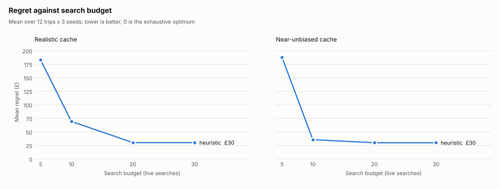

# Benchmark

1 planner(s) x 12 trips x 3 seeds (0, 1, 2) x budgets 5, 10, 20, 30. Regret = optimum utility - best found, in £; lower is better, 0 is the exhaustive optimum. Means are over runs that found an itinerary; misses are shown in the cell.

Command: `uv run python -m app.bench --planners heuristic --budgets 5 10 20 30 --seeds 0 1 2 --out ../reports/latest`

## Mean regret (£), realistic cache

| Planner | Budget 5 | Budget 10 | Budget 20 | Budget 30 |
| --- | --- | --- | --- | --- |
| heuristic | 183 | 69 | 30 | 30 |

## Mean regret (£), near-unbiased cache

| Planner | Budget 5 | Budget 10 | Budget 20 | Budget 30 |
| --- | --- | --- | --- | --- |
| heuristic | 188 | 36 | 30 | 30 |

## Searches used, mean, realistic cache

| Planner | Budget 5 | Budget 10 | Budget 20 | Budget 30 |
| --- | --- | --- | --- | --- |
| heuristic | 4.9 | 9.2 | 15.6 | 15.6 |

## Runs that reached the optimum, realistic cache

| Planner | Budget 5 | Budget 10 | Budget 20 | Budget 30 |
| --- | --- | --- | --- | --- |
| heuristic | 2/36 | 4/36 | 6/36 | 6/36 |

## Wall time per run, mean ms, realistic cache

| Planner | Budget 5 | Budget 10 | Budget 20 | Budget 30 |
| --- | --- | --- | --- | --- |
| heuristic | 60 | 62 | 62 | 61 |

## Mean regret (£) by trip: heuristic, realistic cache

| Trip | Budget 5 | Budget 10 | Budget 20 | Budget 30 |
| --- | --- | --- | --- | --- |
| oj-spec-dates | 33 | 27 | 2 | 2 |
| rt-spec-dates | 21 | 0 | 0 | 0 |
| oj-flex3 | 248 | 108 | 19 | 19 |
| rt-flex3 | 67 | 19 | 19 | 19 |
| oj-flex7 | 248 | 105 | 82 | 82 |
| oj-early-may | 247 | 75 | 61 | 61 |
| oj-late-june | 247 | 104 | 100 | 100 |
| oj-stopover-lover | 365 | 108 | 19 | 19 |
| oj-no-stopovers | 34 | 34 | 19 | 19 |
| oj-time-poor | 416 | 176 | 19 | 19 |
| oj-budget-traveller | 187 | 68 | 15 | 15 |
| rt-one-week | 81 | 7 | 7 | 7 |
