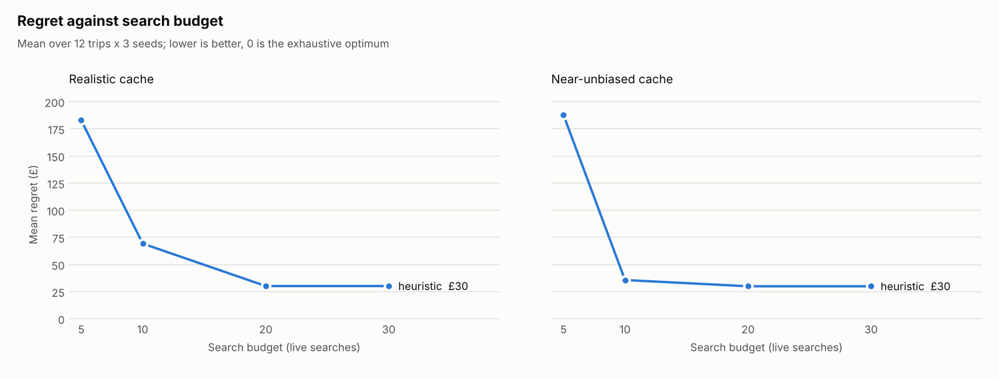

# Session report: F5-benchmark-report (2026-11-07)

## Tests
- Unit tests: 48 passed, 0 failed (45 before; `tests/test_bench_report.py` adds 3: misses shown in the cell, end-label
  spreading, the CLI writes all three files).
- Acceptance: F1-F5 pass (`test_simulator.py` x3, `test_benchmark.py` x2).
- Features passing: 5/22.

## Metrics
`cd backend && uv run python -m app.bench --planners heuristic --budgets 5 10 20 30 --seeds 0 1 2 --out ../reports/latest`
(heuristic is the only planner so far). It runs both cache settings by default and took 56 s.

Mean regret (£), from `reports/latest/bench.md`:

| Planner | Cache | Budget 5 | Budget 10 | Budget 20 | Budget 30 |
| --- | --- | --- | --- | --- | --- |
| heuristic | realistic | 183 | 69 | 30 | 30 |
| heuristic | near-unbiased | 188 | 36 | 30 | 30 |

- Runs at the optimum (realistic): 2/36, 4/36, 6/36, 6/36.
- Mean searches used: 4.9 / 9.2 / 15.6 / 15.6.
- Wall time per run: 60-63 ms.

**Against the previous report (F4):** mean regret, searches used and runs at the optimum are identical at every
budget; same planner, trips and seeds, now run by the CLI instead of a scratch script. Wall time: about 27 s per cache
setting then, 56 s for both now, so no change.

## UI
Not run: nothing under `frontend/` or the API changed. The chart was checked by eye: the real one-planner chart, plus a
layout-only render with three made-up planners (scaled copies of the heuristic, never committed). That check found
overlapping end labels, now fixed.

## What changed
- `app/bench/__main__.py`: `python -m app.bench` with `--planners`, `--budgets`, `--seeds`, `--trips`, `--cache`,
  `--out`. Defaults are every registered planner, budgets 5/10/20/30, seeds 0-2, all 12 trips, both caches and
  `../reports/latest`.
- `app/bench/report.py`: `bench.md` holds the ablation table per cache, searches used, runs at the optimum, wall time
  and regret by trip. A miss shows in its cell (`10 (1 missed)`), never silently.
- `regret.png`: one line per planner, one panel per cache, shared y-axis from 0. It uses the dataviz reference palette
  with a fixed colour per planner (heuristic blue, llm orange, voi-gp aqua, voi-hier yellow), so colours stay put as
  planners are added. The palette validator passes all hard checks. It warns that aqua and yellow are below 3:1
  contrast, so every line carries a direct end label and `bench.md` is the table view.
- `matplotlib` added to `pyproject.toml` (3.11.2).
- `reports/latest/` committed, since F19's how-it-works page renders from it.

## Open problems
- **Light mode only.** The PNG has no dark variant. F19 can either render `bench.json` natively or show the PNG on a
  light card.
- **Wall time varies.** `wall_ms` changes on every run, so `bench.json` differs on each regeneration even when nothing
  else does.
- **Cost will grow.** The benchmark takes 56 s with one planner. The `llm` planner (F8) will add real API cost and
  time per run, so it will need its own budget or a recorded replay.
